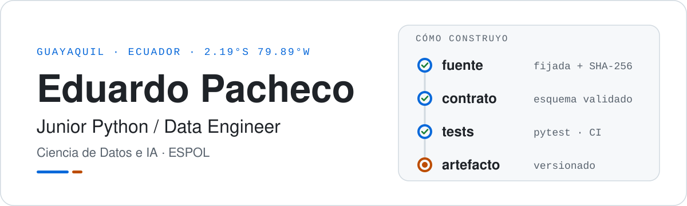
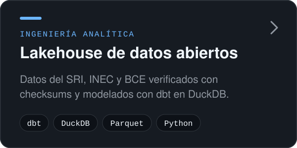
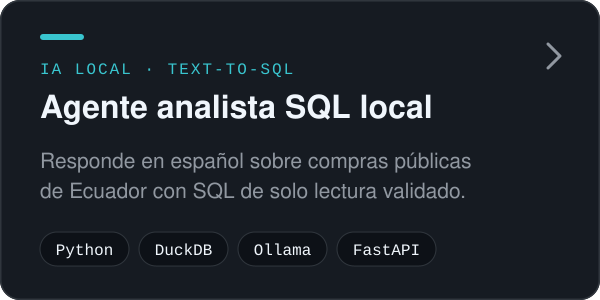
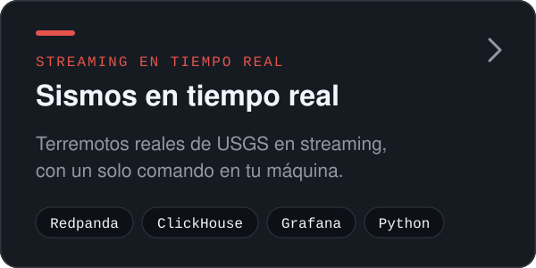
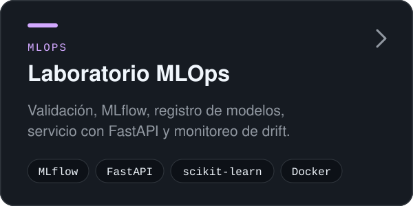
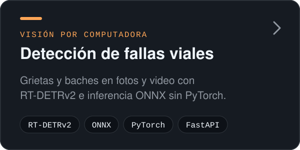

<picture>
  <source media="(prefers-color-scheme: dark)" srcset="assets/hero-dark.svg">
  
</picture>

  

  
  
  

## Sobre mí

Estudio Ciencia de Datos e IA en [ESPOL](https://www.espol.edu.ec) y construyo **pipelines de datos que otra persona puede volver a ejecutar**: fuentes fijadas con checksums, contratos explícitos, pruebas en CI y resultados con su alcance declarado. Trabajo con Python, SQL, FastAPI y Docker, y mis proyectos más recientes corren por completo en local, sin cuentas ni APIs de pago.

> *English: junior Python / data engineer from Ecuador building reproducible, tested data pipelines and local-first ML tools.*

## Proyectos destacados

<table>
  <tr>
    <td width="50%"></td>
    <td width="50%"></td>
  </tr>
  <tr>
    <td width="50%"></td>
    <td width="50%"></td>
  </tr>
  <tr>
    <td width="50%"></td>
    <td width="50%"></td>
  </tr>
</table>

<b>Más proyectos</b>

 

- [**Indicadores Ecuador**](https://github.com/Eduardo12Pacheco/indicadores-ecuador-escritorio) — app de escritorio offline para explorar indicadores del Banco Mundial (Tauri, Rust y React).
- [**Clasificador de texto LoRA**](https://github.com/Eduardo12Pacheco/clasificador-de-texto-lora) — 60 intenciones en español con MrBERT-es ajustado con LoRA y servido con ONNX en CPU.
- [**Plataforma de inteligencia de decisiones**](https://github.com/Eduardo12Pacheco/plataforma-inteligencia-decisiones-ecuador) — ingesta programada con FastAPI y SQLite, con estados de falla observables.
- [**Sistema RAG con evidencia**](https://github.com/Eduardo12Pacheco/sistema-rag-con-evidencia) — recuperación híbrida, citas validadas y abstención cuando no hay evidencia.
- [**Motor de demanda e inventario retail**](https://github.com/Eduardo12Pacheco/motor-demanda-inventario-retail) — pronóstico de demanda, simulación de políticas de inventario y análisis de robustez.
- [**Auditoría del transporte público de Cuenca**](https://github.com/Eduardo12Pacheco/auditoria-transporte-publico-cuenca) — auditoría del servicio planificado de Cuenca: 76 rutas, 383 paradas y validación estricta contra manifiestos.
- [**Mercado laboral de Ecuador**](https://github.com/Eduardo12Pacheco/mercado-laboral-ecuador) — ingesta y evaluación de habilidades en ofertas laborales, con citas exactas y revisión humana.
- [**MinuteCutter**](https://github.com/Eduardo12Pacheco/minutecutter-panel-premiere) — panel CEP para Premiere Pro que corta rangos desde el material fuente, con audio vinculado y sin mover el resto del timeline.

## Stack

   
    
  
  
  
  
  
  

## Cómo trabajo

- **Evidencia antes que afirmaciones** — cada resultado tiene un comando reproducible y un denominador declarado.
- **Contratos y pruebas primero** — validación estricta de fuentes, comportamiento *fail-closed* y tests que fijan lo esperado.
- **Alcance honesto** — las limitaciones y lo que no se cubrió quedan escritas, no ocultas.

## Busco

Roles junior de **Python / Backend**, **Data Engineer**, **ETL** y **Analytics Engineer**, en remoto o en Guayaquil, donde pueda aportar desde el primer día y seguir aprendiendo.

 

<picture>
  <source media="(prefers-color-scheme: dark)" srcset="https://raw.githubusercontent.com/Eduardo12Pacheco/Eduardo12Pacheco/output/snake-dark.svg">
  
</picture>
